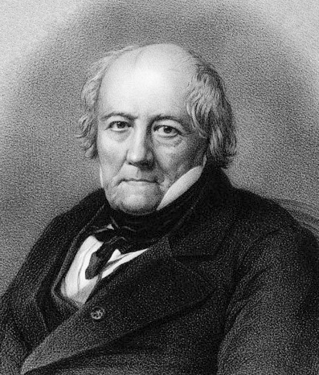

# Jean-Baptiste Biot

**Born:** 21 April 1774

**Died / status:** 3 February 1862

**Fields:** Electromagnetism, Polarization optics, Experimental physics

The creator, date and form of this likeness are documented at the image source.

## Biography

Biot was a French physicist and astronomer educated at the École Polytechnique who taught and researched in Paris. He joined surveying and balloon observations, investigated the magnetic effects of current with Savart and connected optics to material properties through optical rotation.

## Major contributions to physics

- Established the quantitative magnetic-field relation associated with Biot and Savart.
- Investigated optical rotation and helped make polarized light a probe of material properties.

## Image source and rights

- Source: [Original image record](https://commons.wikimedia.org/wiki/File:Jean_baptiste_biot.jpg)
- Creator / attribution: Auguste Lemoine (?)
- License or rights statement: Public domain
- Local image: [3762cdbdb6b4d0814d70.jpg](../portraits/3762cdbdb6b4d0814d70.jpg)
- Credit: https://www.sil.si.edu/digitalcollections/hst/scientific-identity/cf/display_results.cfm?alpha_sort=b

## Sources

- [MacTutor History of Mathematics — Jean-Baptiste Biot](https://mathshistory.st-andrews.ac.uk/Biographies/Biot/)
- [Wikipedia — Jean-Baptiste Biot](https://en.wikipedia.org/wiki/Jean-Baptiste_Biot)

Record reviewed: 2026-10-26.
