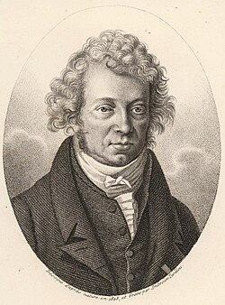

# André-Marie Ampère

**Born:** 20 January 1775

**Died / status:** 10 June 1836

**Fields:** Electrodynamics, Magnetism

The creator, date and form of this likeness are documented at the image source.

## Biography

Ampère was a largely self-taught French mathematician and physicist who taught in Lyon and Paris. After Ørsted's discovery of the magnetic effect of current, he rapidly began experiments on forces between currents and developed a central theoretical framework of nineteenth-century electrodynamics.

## Major contributions to physics

- Investigated forces between electrical currents and formulated laws of electrodynamics.
- Proposed microscopic circulating currents as an explanation of magnetism, advancing connections between electrical and magnetic phenomena.

## Image source and rights

- Source: [Original image record](https://commons.wikimedia.org/wiki/File:Ampere_Andre_1825.jpg)
- Creator / attribution: Ambroise Tardieu
- License or rights statement: Public domain
- Local image: [f85ac97a37ef2f327ff9.jpg](../portraits/f85ac97a37ef2f327ff9.jpg)
- Credit: The Dibner collection ::::::::::,,,;at the Smithsonian Institution (USA),

## Sources

- [MacTutor History of Mathematics — André-Marie Ampère](https://mathshistory.st-andrews.ac.uk/Biographies/Ampere/)
- [Wikipedia — André-Marie Ampère](https://en.wikipedia.org/wiki/Andr%C3%A9-Marie_Amp%C3%A8re)

Record reviewed: 2026-10-26.
