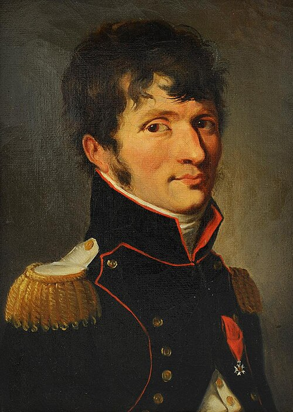

# Étienne-Louis Malus

**Born:** 23 July 1775

**Died / status:** 24 February 1812

**Fields:** Polarization optics, Geometrical optics

The creator, date and form of this likeness are documented at the image source.

## Biography

Malus was a French military engineer and physicist educated at the École Polytechnique who took part in the Egyptian expedition. His main research concerned optics. Observations of sunlight reflected from glass led him to polarization, which he investigated with quantitative intensity relations.

## Major contributions to physics

- Discovered the polarization of light by reflection.
- Formulated Malus's law for the intensity of linearly polarized light transmitted through an analyzer.

## Image source and rights

- Source: [Original image record](https://commons.wikimedia.org/wiki/File:Malus_by_Boilly_1810.jpg)
- Creator / attribution: Louis-Léopold Boilly (1761–1845)
- License or rights statement: [Public domain](https://commons.wikimedia.org/wiki/Commons:Reuse_of_PD-Art_photographs)
- Local image: [61f9657a0e19c8627079.jpg](../portraits/61f9657a0e19c8627079.jpg)
- Credit: https://s3-eu-west-1.amazonaws.com/bertrand-malvaux.com/web/images/1/produits3/6/produit_image3_33806_1584441567.JPG

## Sources

- [MacTutor History of Mathematics — Étienne-Louis Malus](https://mathshistory.st-andrews.ac.uk/Biographies/Malus/)
- [Wikipedia — Étienne-Louis Malus](https://en.wikipedia.org/wiki/%C3%89tienne-Louis_Malus)

Record reviewed: 2026-10-26.
