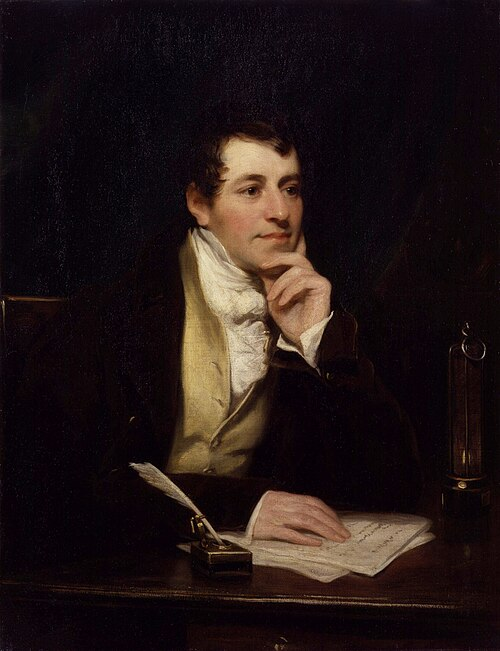

# Humphry Davy

**Born:** 17 December 1778

**Died / status:** 29 May 1829

**Fields:** Electrochemistry, Electric-arc physics, Applied thermal physics

The creator, date and form of this likeness are documented at the image source.

## Biography

Davy was a British chemist and experimental scientist from Cornwall who directed experiments and public lectures at London's Royal Institution. He used large batteries to investigate matter and isolate elements and developed a safety lamp for miners. Faraday initially worked as his assistant.

## Major contributions to physics

- Used electrolysis to investigate relationships between matter and electricity, advancing electrochemistry.
- Investigated electric arcs and conduction with strong currents.
- Developed the miners' safety lamp by applying knowledge of combustion and heat transfer.

## Image source and rights

- Source: [Original image record](https://commons.wikimedia.org/wiki/File:Sir_Humphry_Davy%2C_Bt_by_Thomas_Phillips.jpg)
- Creator / attribution: Thomas Phillips (1770–1845)
- License or rights statement: [Public domain](https://commons.wikimedia.org/wiki/Commons:Reuse_of_PD-Art_photographs)
- Local image: [427b0a12c8d172859dc8.jpg](../portraits/427b0a12c8d172859dc8.jpg)
- Credit: National Portrait Gallery: NPG 2546

## Sources

- [Royal Institution — Sir Humphry Davy](https://www.rigb.org/explore-science/explore/person/sir-humphry-davy-1778-1829)
- [Wikipedia — Humphry Davy](https://en.wikipedia.org/wiki/Humphry_Davy)

Record reviewed: 2026-10-26.
