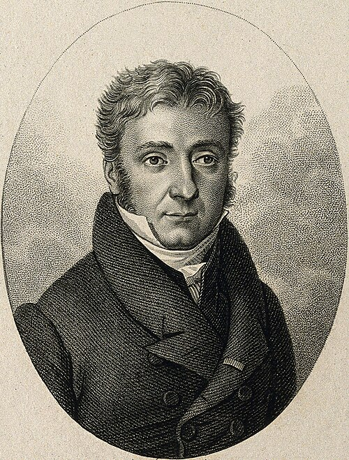

# Pierre Louis Dulong

**Born:** 12 or 13 February 1785

**Died / status:** 19 July 1838

**Fields:** Thermal physics, Calorimetry, Gas physics

The creator, date and form of the image are documented at its source; later representations are not verified contemporary likenesses.

## Biography

Dulong was a French chemist and physicist who became a professor and director at the École Polytechnique. He studied specific heat, gases, thermal expansion and cooling. Measurements of solid heat capacities with Petit connected atomic ideas to thermal measurement.

## Major contributions to physics

- Discovered with Petit the approximate similarity of molar heat capacities of many solid elements in a suitable temperature range.
- Performed experiments on gases, thermal radiation and thermometry, advancing precision thermal physics.

## Historical and source notes

- Birth is given as 12 or 13 February 1785; CTHS gives 13 February, so the month and discrepancy are retained.
- The Dulong–Petit law is approximate in an appropriate temperature range and fails in conditions including sufficiently low temperatures.

## Image source and rights

- Source: [Original image record](https://commons.wikimedia.org/wiki/File:Pierre_Louis_Dulong.jpg)
- Creator / attribution: Wilhelm Ostwald
- License or rights statement: Public domain
- Local image: [4491b0ca3fadc85394a6-440918948f.jpg](../portraits/4491b0ca3fadc85394a6-440918948f.jpg)
- Credit: Elektrochemie - Ihre Geschichte und Lehre

## Sources

- [CTHS — Pierre Louis Dulong](https://www.cths.fr/an/savant.php?id=101613)
- [Wikipedia — Pierre Louis Dulong](https://en.wikipedia.org/wiki/Pierre_Louis_Dulong)

Record reviewed: 2026-10-26.
