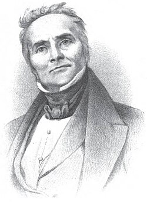

# Jean Charles Athanase Peltier

**Born:** 22 February 1785

**Died / status:** 27 October 1845

**Fields:** Thermoelectricity, Electrical science

The creator, date and form of the image are documented at its source; later representations are not verified contemporary likenesses.

## Biography

Peltier was a French physicist who initially worked in the watch trade and turned mainly to experimental research around the age of thirty. He investigated electricity, heat and atmospheric phenomena. In 1834 he reported current-dependent heating and cooling at junctions of different materials, providing a foundation for thermoelectric cooling.

## Major contributions to physics

- Discovered the Peltier effect: heat absorption or release when current passes through a junction of dissimilar conductors.
- Investigated precision electrical measurement, atmospheric electricity and temperature phenomena, extending thermoelectric experimentation.

## Image source and rights

- Source: [Original image record](https://commons.wikimedia.org/wiki/File:Jean_Charles_Athanase_Peltier.jpg)
- Creator / attribution: Unknown XIX century artist
- License or rights statement: Public domain
- Local image: [8f849bcac9316a07a65d-3ff29af26c.jpg](../portraits/8f849bcac9316a07a65d-3ff29af26c.jpg)
- Credit: http://www.thermoelectrics.caltech.edu/thermoelectrics/history.html

## Sources

- [Florida State University MagLab Magnet Academy — Jean-Charles-Athanase Peltier](https://maglabweb.magnet.fsu.edu/magnet-academy/history-of-electricity-magnetism/pioneers/jean-charles-athanase-peltier/)
- [Technical University of Munich — Jean Charles Athanase Peltier](https://av.ph.nat.tum.de/Bios/Peltier.php)
- [Wikipedia — Jean Charles Athanase Peltier](https://en.wikipedia.org/wiki/Jean_Charles_Athanase_Peltier)

Record reviewed: 2026-10-26.
