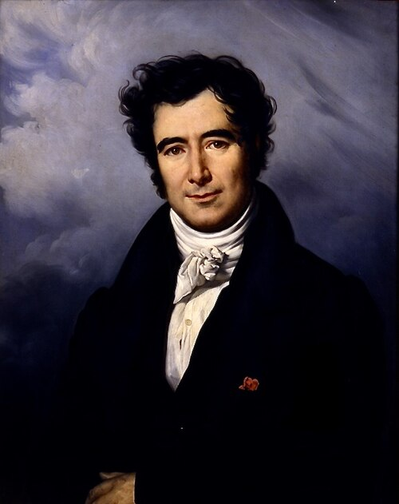

# François Arago

**Born:** 26 February 1786

**Died / status:** 2 October 1853

**Fields:** Electromagnetism, Wave optics, Astronomy

The creator, date and form of this likeness are documented at the image source.

## Biography

Arago was a French physicist, astronomer and political figure who joined the measurement of the French meridian and later worked at the Paris Observatory and Academy. He investigated polarization, interference and magnetic effects and played an important organizing and public role in nineteenth-century French experimental science.

## Major contributions to physics

- Discovered the action of a rotating metal disk on a magnetic needle, associated with Arago's rotations.
- Investigated interference of polarized light with Fresnel, supporting a transverse-wave account of light.
- Promoted astronomical measurement, instrumental research and scientific communication.

## Image source and rights

- Source: [Original image record](https://commons.wikimedia.org/wiki/File:Fran%C3%A7ois_Arago_by_Carl_von_Steuben.jpg)
- Creator / attribution: Charles de Steuben
- License or rights statement: Public domain
- Local image: [7ef0b01d4c6c40ddff07.jpg](../portraits/7ef0b01d4c6c40ddff07.jpg)
- Credit: https://www.obspm.fr/arago-et-biot-aux-baleares-la.html?lang=fr

## Sources

- [MacTutor History of Mathematics — François Arago](https://mathshistory.st-andrews.ac.uk/Biographies/Arago/)
- [Wikipedia — François Arago](https://en.wikipedia.org/wiki/Fran%C3%A7ois_Arago)

Record reviewed: 2026-10-26.
