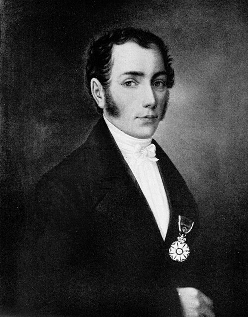

# Joseph von Fraunhofer

**Born:** 6 March 1787

**Died / status:** 7 June 1826

**Fields:** Spectroscopy, Diffraction, Optical instruments

The creator, date and form of the image are documented at its source; later representations are not verified contemporary likenesses.

## Biography

Fraunhofer was a Bavarian optician and physicist who began as an apprentice glassworker and later directed optical-glass and instrument production in Benediktbeuern and Munich. Combining materials work, precision measurement and research, he mapped dark solar-spectrum lines and advanced spectroscopy and astronomical instrumentation.

## Major contributions to physics

- Systematically mapped dark lines in the solar spectrum, establishing precision references for spectroscopy.
- Developed diffraction gratings and wavelength measurements and improved optical glass, achromatic lenses and telescopes.

## Image source and rights

- Source: [Original image record](https://commons.wikimedia.org/wiki/File:Joseph_v_Fraunhofer.jpg)
- Creator / attribution: Unknown author
- License or rights statement: Public domain
- Local image: [b32e644c930757e33e6c-9ab9c1a585.jpg](../portraits/b32e644c930757e33e6c-9ab9c1a585.jpg)
- Credit: Scanned from "Die großen Deutschen im Bilde" (1936) by Michael Schönitzer

## Sources

- [Fraunhofer-Gesellschaft — Joseph von Fraunhofer, biography and timeline](https://www.fraunhofer.de/en/about-fraunhofer/profile-structure/chronicles/joseph-von-fraunhofer.html)
- [Wikipedia — Joseph von Fraunhofer](https://en.wikipedia.org/wiki/Joseph_von_Fraunhofer)

Record reviewed: 2026-10-26.
