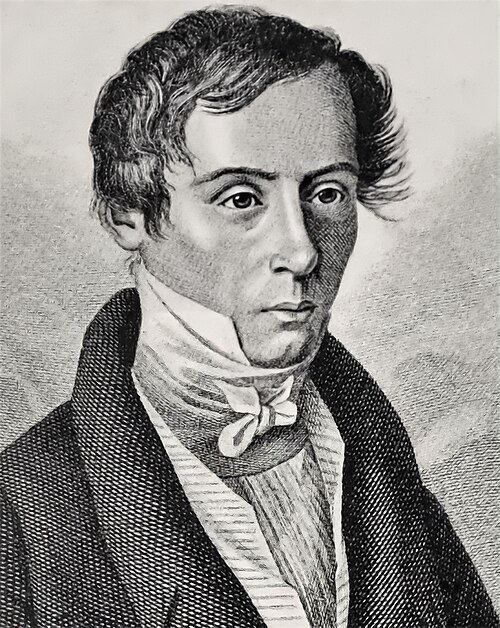

# Augustin-Jean Fresnel

**Born:** 10 May 1788

**Died / status:** 14 July 1827

**Fields:** Wave optics, Polarization, Optical engineering

The creator, date and form of this likeness are documented at the image source.

## Biography

Fresnel was a French civil engineer whose optical experiments brought him to the attention of the Academy. His mathematical analysis of interference and diffraction helped establish wave optics. He also developed lighthouse optics and died shortly after receiving important international recognition.

## Major contributions to physics

- Established a diffraction theory combining wave propagation and interference to explain optical phenomena.
- Developed transverse-wave and polarization theories and the interface reflection and refraction relations bearing his name.
- Designed the Fresnel lens, improving lighthouse illumination.

## Image source and rights

- Source: [Original image record](https://commons.wikimedia.org/wiki/File:Augustin_Fresnel.jpg)
- Creator / attribution: E Rosette after a painting by A Tardieu
- License or rights statement: Public domain
- Local image: [839ab36238902eef26ee.jpg](../portraits/839ab36238902eef26ee.jpg)
- Credit: Plate II, Light and Colour, by RA Houstoun, 1903

## Sources

- [MacTutor History of Mathematics — Augustin-Jean Fresnel](https://mathshistory.st-andrews.ac.uk/Biographies/Fresnel/)
- [Wikipedia — Augustin-Jean Fresnel](https://en.wikipedia.org/wiki/Augustin-Jean_Fresnel)

Record reviewed: 2026-10-26.
