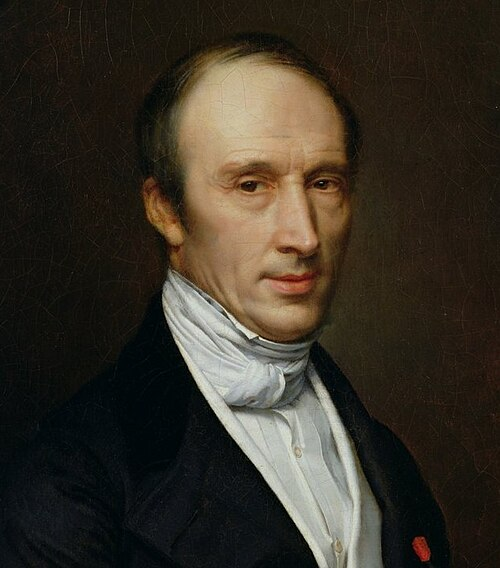

# Augustin-Louis Cauchy

**Born:** 21 August 1789

**Died / status:** 23 May 1857

**Fields:** Continuum mechanics, Elasticity, Mathematical physics

The creator, date and form of the image are documented at its source; later representations are not verified contemporary likenesses.

## Biography

Cauchy was a French mathematician trained in engineering who taught in Paris and experienced exile and changes of appointment shaped by politics and religion. Alongside foundational analysis, he systematically investigated elasticity, stress, waves and continua, extending differential-equation methods in physical theory.

## Major contributions to physics

- Developed stress-tensor and traction descriptions for continua, advancing elasticity theory.
- Investigated waves, optics and fluids and supplied rigorous analytical tools used in physics.

## Image source and rights

- Source: [Original image record](https://commons.wikimedia.org/wiki/File:French_School_-_Portrait_of_Augustin-Louis_Cauchy_(1789-1857).jpg)
- Creator / attribution: Jean Roller (1798–1866)
- License or rights statement: Public domain
- Local image: [3ad59cc3b431f0a983d4-4459928a71.jpg](../portraits/3ad59cc3b431f0a983d4-4459928a71.jpg)
- Credit: meisterdrucke.uk

## Sources

- [MacTutor History of Mathematics — Augustin-Louis Cauchy](https://mathshistory.st-andrews.ac.uk/Biographies/Cauchy/)
- [Wikipedia — Augustin-Louis Cauchy](https://en.wikipedia.org/wiki/Augustin-Louis_Cauchy)

Record reviewed: 2026-10-26.
