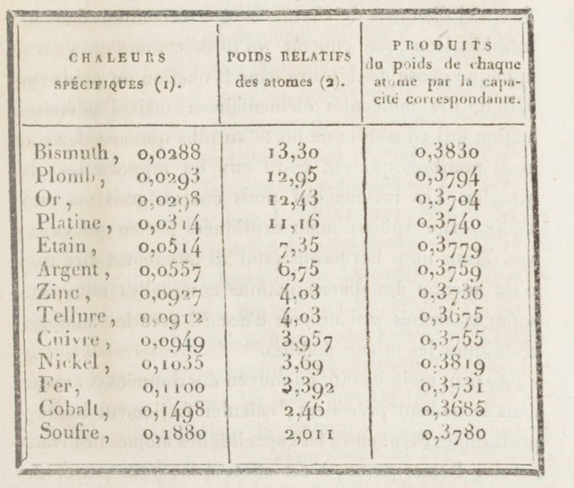

# Alexis Thérèse Petit

**Born:** 2 October 1791

**Died / status:** 21 June 1820

**Fields:** Calorimetry, Thermometry

No verified suitable portrait of Petit was obtained. Extracted directly from a PDF hosted by ENS de Lyon, this is the experimental table from Petit and Dulong’s 1819 heat paper, listing specific heats, relative atomic weights and their products. It is a paper image rather than a portrait.

## Biography

Petit was a French physicist whose early mathematical ability led to study and teaching at the École Polytechnique. With Dulong he investigated solid specific heats, gas thermometry and cooling. Despite dying young, his measurements became important evidence for nineteenth-century atomic and material studies.

## Major contributions to physics

- Established with Dulong an approximate empirical law for the molar heat capacities of solid elements.
- Investigated cooling, thermal expansion and thermometry, improving quantitative thermal experiments.

## Historical and source notes

- The Dulong–Petit law is not an exact universal equality for every solid at every temperature.

## Image source and rights

- Source: [Original image record](https://perso.ens-lyon.fr/benjamin.monnet/LP/LP44%20Capacit%C3%A9s%20thermique.%20Description%2C%20interp%C3%A9tations%20miscroscopiques/Petit.pdf)
- Creator / attribution: Alexis-Thérèse Petit and Pierre-Louis Dulong
- License or rights statement: [Public-domain original: Petit and Dulong, Annales de chimie et de physique 10 (1819), pp. 395–413; faithful scan, no separate scan license stated.](https://creativecommons.org/publicdomain/mark/1.0/)
- Local image: [cb04008e5a02169c5ff1-b690f9efd7.png](../portraits/cb04008e5a02169c5ff1-b690f9efd7.png)
- Credit: Petit and Dulong (1819); scan reproduced in an ENS de Lyon-hosted teaching resource

## Sources

- [MacTutor History of Mathematics — Alexis Thérèse Petit](https://mathshistory.st-andrews.ac.uk/Biographies/Petit/)
- [Wikipedia — Alexis Thérèse Petit](https://en.wikipedia.org/wiki/Alexis_Th%C3%A9r%C3%A8se_Petit)

Record reviewed: 2026-10-26.
