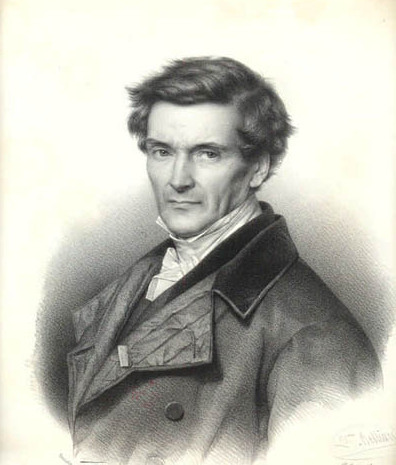

# Gaspard-Gustave de Coriolis

**Born:** 21 May 1792

**Died / status:** 19 September 1843

**Fields:** Classical mechanics, Rotating reference frames, Engineering mechanics

The creator, date and form of the image are documented at its source; later representations are not verified contemporary likenesses.

## Biography

Coriolis was a French engineer and mathematical physicist associated with the bridges-and-roads service and the École Polytechnique. He studied mechanical work, collisions and rotating systems. In 1835 he explicitly formulated additional inertial-force terms for rotating frames, later widely applied in geophysics.

## Major contributions to physics

- Formulated the velocity-dependent Coriolis term in the dynamics of rotating reference frames.
- Advanced quantitative engineering treatments of mechanical work and kinetic energy and investigated machines and collisions.

## Image source and rights

- Source: [Original image record](https://commons.wikimedia.org/wiki/File:Gaspard-Gustave_de_Coriolis.jpg)
- Creator / attribution: gravure de Zéphyrin Belliard d'après le tableau de Roller (1812-1866)
- License or rights statement: Public domain
- Local image: [20a12f71955c5228483a-45fdc2ef71.jpg](../portraits/20a12f71955c5228483a-45fdc2ef71.jpg)
- Credit: http://www.sabix.org/bulletin/b5/coriolis.html (link dead per 2025-09-27, archived version)

## Sources

- [MacTutor History of Mathematics — Gaspard-Gustave de Coriolis](https://mathshistory.st-andrews.ac.uk/Biographies/Coriolis/)
- [Wikipedia — Gaspard-Gustave de Coriolis](https://en.wikipedia.org/wiki/Gaspard-Gustave_de_Coriolis)

Record reviewed: 2026-10-26.
