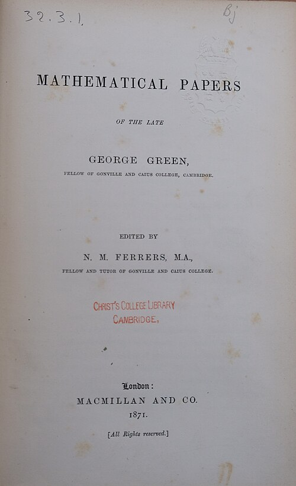

# George Green

**Born:** 1793 (baptized 14 July; exact birth date unknown)

**Died / status:** 31 May 1841

**Fields:** Potential theory, Mathematical physics

No verified portrait was obtained. This is the title page of the 1871 Mathematical Papers of the Late George Green, from the Niels Bohr Library & Archives at the American Institute of Physics. It is a work image rather than a portrait.

## Biography

Green was an English mathematician from Nottingham who worked in a mill and studied mathematics largely independently before attending Cambridge. His 1828 essay applied potential functions and boundary methods to electricity and magnetism. Later work treated light, sound and elasticity, gaining wider recognition after his death.

## Major contributions to physics

- Developed Green's functions and integral identities as general methods for potential and boundary-value problems.
- Applied mathematics to electricity, magnetism, waves and elastic media, providing important tools for field calculations.

## Historical and source notes

- 14 July is the date of baptism; the exact birth date is unknown. MacTutor lists it as the birth date in its summary, but its biography explicitly identifies it as a baptismal record. The archive retains the year and labels the ritual date separately.

## Image source and rights

- Source: [Original image record](https://commons.wikimedia.org/wiki/File:Green-3.jpg)
- Creator / attribution: George Green / Niels Bohr Library & Archives, AIP
- License or rights statement: [Public domain, as recorded by Wikimedia Commons](https://creativecommons.org/publicdomain/mark/1.0/)
- Local image: [dbead3dd800569069a3e-e94333d7ba.jpg](../portraits/dbead3dd800569069a3e-e94333d7ba.jpg)
- Credit: George Green / Niels Bohr Library & Archives, AIP

## Sources

- [MacTutor History of Mathematics — George Green](https://mathshistory.st-andrews.ac.uk/Biographies/Green/)
- [Wikipedia — George Green](https://en.wikipedia.org/wiki/George_Green_%28mathematician%29)

Record reviewed: 2026-10-26.
