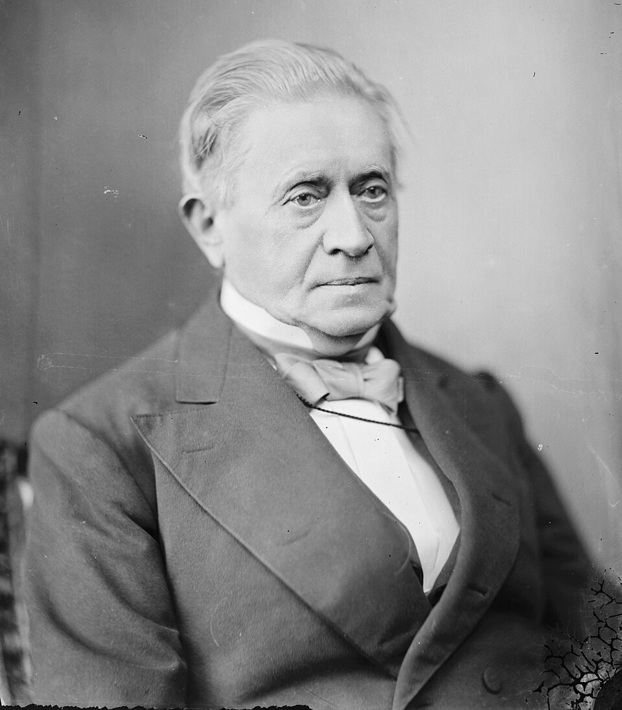

# Joseph Henry

**Born:** 17 December 1797

**Died / status:** 13 May 1878

**Fields:** Electromagnetism, Inductance, Experimental physics

The creator, date and form of this likeness are documented at the image source.

## Biography

Henry was an American physicist who taught at Albany Academy and the College of New Jersey, later Princeton, and became the Smithsonian Institution's first secretary in 1846. Alongside electromagnetic experiments, he organized research, publication and scientific exchange, helping build American scientific institutions.

## Major contributions to physics

- Constructed powerful electromagnets and investigated the design of coils and electromagnetic devices.
- Independently investigated induction and discovered self-induction, contributing to the study of inductance and telegraphic technology.

## Image source and rights

- Source: [Original image record](https://commons.wikimedia.org/wiki/File:Joseph_Henry_-_Brady-Handy.jpg)
- Creator / attribution: Mathew Brady or Levin Handy
- License or rights statement: [Public domain](https://commons.wikimedia.org/wiki/Library_of_Congress)
- Local image: [79287d0bab60cc7bcd90.jpg](../portraits/79287d0bab60cc7bcd90.jpg)
- Credit: Library of Congress Prints and Photographs Division. Brady-Handy Photograph Collection. http://hdl.loc.gov/loc.pnp/cwpbh.05156. CALL NUMBER: LC-BH832- 30887 [P&P]

## Sources

- [Smithsonian Institution Archives — Joseph Henry’s Life](https://siarchives.si.edu/history/featured-topics/henry/joseph-henrys-life)
- [Smithsonian — Joseph Henry Collection chronology](https://www.si.edu/object/archives/sova-sia-faru7001?edan_fq%5B0%5D=-online_visual_material%3A%22false%22)
- [Wikipedia — Joseph Henry](https://en.wikipedia.org/wiki/Joseph_Henry)

Record reviewed: 2026-10-26.
