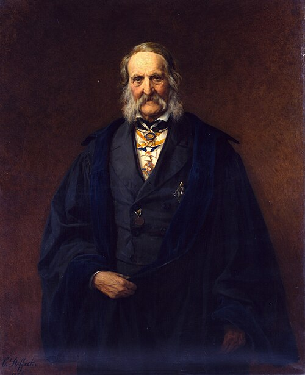

# Franz Ernst Neumann

**Born:** 11 September 1798

**Died / status:** 23 May 1895

**Fields:** Electromagnetism, Crystal physics, Mathematical physics

The creator, date and form of the image are documented at its source; later representations are not verified contemporary likenesses.

## Biography

Franz Ernst Neumann was a German physicist and mineralogist who taught in Königsberg and organized a mathematical-physics seminar with Jacobi. He investigated crystals, elasticity, induction and optics, combining precision experiments with theory and teaching physicists including Kirchhoff.

## Major contributions to physics

- Developed mathematical theories of electromagnetic induction, including interacting circuits.
- Investigated relationships between crystal symmetry and physical properties and advanced elasticity and optics.

## Image source and rights

- Source: [Original image record](https://commons.wikimedia.org/wiki/File:Franz_Ernst_Neumann_by_Carl_Steffeck_1886.jpg)
- Creator / attribution: See the original image record
- License or rights statement: Public domain
- Local image: [1525f2bf8078e3465d35-0a1592f878.jpg](../portraits/1525f2bf8078e3465d35-0a1592f878.jpg)

## Sources

- [Deutsche Biographie — Franz Ernst Neumann](https://www.deutsche-biographie.de/118786008.html?language=en)
- [Wikipedia — Franz Ernst Neumann](https://en.wikipedia.org/wiki/Franz_Ernst_Neumann)

Record reviewed: 2026-10-26.
