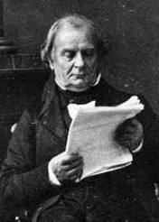

# Benoît Paul Émile Clapeyron

**Born:** 26 January 1799

**Died / status:** 28 January 1864

**Fields:** Thermodynamics, Phase equilibrium, Structural mechanics

The creator, date and form of the image are documented at its source; later representations are not verified contemporary likenesses.

## Biography

Clapeyron was a French engineer and physicist who worked in St Petersburg before returning to railway engineering and teaching in France. He recast Sadi Carnot's engine arguments mathematically and graphically and also studied phase equilibrium and beams, contributing to the emergence of thermodynamics.

## Major contributions to physics

- Reformulated Carnot's engine theory using tools including pressure-volume diagrams, helping disseminate it.
- Established the Clapeyron relation linking pressure, temperature and latent heat at a phase transition and investigated structural mechanics.

## Image source and rights

- Source: [Original image record](https://commons.wikimedia.org/wiki/File:BenoitClapeyron_(d%C3%A9tail).jpg)
- Creator / attribution: (Unknown)
- License or rights statement: Public domain
- Local image: [fe3e7e3f40fda1914d9a-527b791426.jpg](../portraits/fe3e7e3f40fda1914d9a-527b791426.jpg)
- Credit: http://www.annales.org/archives/x/clapeyron.html

## Sources

- [MacTutor History of Mathematics — Benoît Paul Émile Clapeyron](https://mathshistory.st-andrews.ac.uk/Biographies/Clapeyron/)
- [Wikipedia — Benoît Paul Émile Clapeyron](https://en.wikipedia.org/wiki/Beno%C3%AEt_Paul_%C3%89mile_Clapeyron)

Record reviewed: 2026-10-26.
