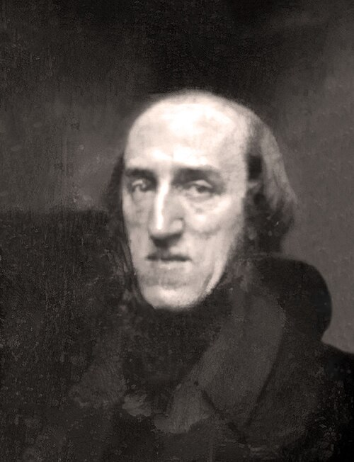

# Joseph Plateau

**Born:** 14 October 1801

**Died / status:** 15 September 1883

**Fields:** Surface physics, Optics, Mathematical physics

For the date, creator, form and attribution of this image, see its source record.

## Biography

Plateau was a Belgian physicist who taught at Ghent and studied vision, apparent motion and liquid surfaces. He continued scientific work with assistance after losing his sight. His soap-film experiments connected observable surface shapes with mathematical questions about minimal surfaces.

## Major contributions to physics

- Established experimental rules for the equilibrium and junctions of soap films
- Used soap films to investigate the minimal surface spanning a boundary
- Studied visual persistence and developed the phenakistiscope, an early moving-image device

## Image source and rights

- Source: [Original image record](https://commons.wikimedia.org/wiki/File:Joseph_Plateau_-_clean.jpg)
- Creator / attribution: Albert Callisto
- License or rights statement: [CC BY-SA 4.0](https://creativecommons.org/licenses/by-sa/4.0)
- Local image: [fd8273ac5f5fcd237a7c.jpg](../portraits/fd8273ac5f5fcd237a7c.jpg)
- Credit: Own work

## Sources

- [Joseph Plateau — MacTutor, University of St Andrews](https://mathshistory.st-andrews.ac.uk/Biographies/Plateau/)
- [Joseph Plateau — Wikipedia — dates and biographical overview](https://en.wikipedia.org/wiki/Joseph_Plateau)

Record reviewed: 2026-10-26.
