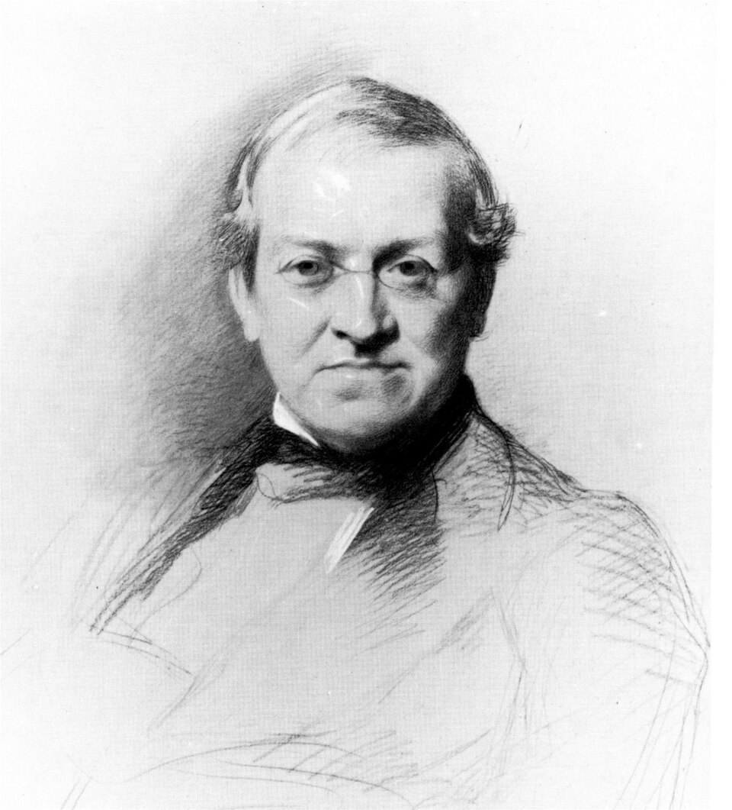

# Charles Wheatstone

**Born:** 6 February 1802

**Died / status:** 19 October 1875

**Fields:** Electromagnetism, Acoustics, Visual optics

For the image’s date, creator, form and attribution, see its source record.

## Biography

Wheatstone was an English physicist and inventor at King's College London. Beginning with acoustics and musical instruments, he turned to vision, electrical measurement and telegraphy. His collaboration with Cooke connected precision experiments with practical communications.

## Major contributions to physics

- Invented the reflecting stereoscope and investigated binocular depth perception
- Popularized and improved bridge methods for measuring electrical resistance
- Developed practical telegraph systems with Cooke and investigated sound and electrical-signal propagation

## Historical and source notes

- Samuel Hunter Christie originally introduced the bridge arrangement; Wheatstone is not described here as its sole inventor.

## Image source and rights

- Source: [Original image record](https://commons.wikimedia.org/wiki/File:Wheatstone_Charles_drawing_1868.jpg)
- Creator / attribution: Samuel Laurence (–1884)
- License or rights statement: [Public domain](https://commons.wikimedia.org/wiki/Commons:Reuse_of_PD-Art_photographs)
- Local image: [a59007609ddc2d2828d1-b10eaae01f.jpg](../portraits/a59007609ddc2d2828d1-b10eaae01f.jpg)
- Credit: Page 53 of Apples to Atoms by W. D. Hackmann (London, ca. 1986)

## Sources

- [Wheatstone Collection — King’s College London](https://www.kcl.ac.uk/wheatstone-collection)
- [Charles Wheatstone — Wikipedia biography](https://en.wikipedia.org/wiki/Charles_Wheatstone)

Record reviewed: 2026-10-26.
