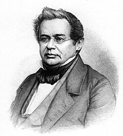

# Heinrich Lenz

**Born:** 24 February 1804

**Died / status:** 10 February 1865

**Fields:** Electromagnetism, Thermal physics, Experimental physics

For the date, creator, form and attribution of this image, see its source record.

## Biography

Born in Dorpat, Lenz spent much of his career teaching and researching in St Petersburg. He took part in a circumnavigation and made oceanographic measurements before becoming particularly known for quantitative investigations of electromagnetic induction and the heating produced by electric currents.

## Major contributions to physics

- Formulated the rule that an induced current opposes the change that produces it
- Independently investigated the relation between electrical heating, current, resistance and time
- Measured electrical resistance and its dependence on temperature

## Historical and source notes

- Dates are given in the Gregorian calendar; the corresponding Old Style dates are 12 February 1804 and 29 January 1865.

## Image source and rights

- Source: [Original image record](https://commons.wikimedia.org/wiki/File:Heinrich_Friedrich_Emil_Lenz.jpg)
- Creator / attribution: Unknown author
- License or rights statement: [Public domain](https://commons.wikimedia.org/wiki/File:Heinrich_Friedrich_Emil_Lenz.jpg)
- Local image: [e2d77e7e2f26bfcebd49.jpg](../portraits/e2d77e7e2f26bfcebd49.jpg)
- Credit: http://www.glowimages.com/imagedetails/42625130/image_of_2489610.Heinrich%20Friedrich%20Emil%20Lenz%20Russian%20German%20physicist%2019th%20century.html (watermark removed)

## Sources

- [Heinrich Lenz — Wikipedia — dates and biographical overview](https://en.wikipedia.org/wiki/Heinrich_Lenz)

Record reviewed: 2026-10-26.
