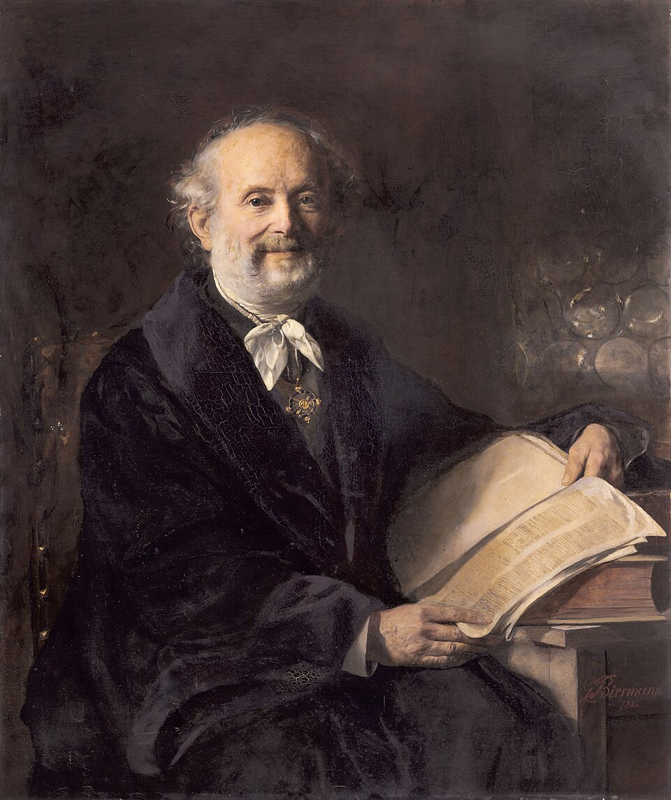

# Wilhelm Eduard Weber

**Born:** 24 October 1804

**Died / status:** 23 June 1891

**Fields:** Electromagnetism, Geomagnetism, Metrology

For the date, creator, form and attribution of this image, see its source record.

## Biography

Weber was a German physicist who collaborated with Gauss in Göttingen on geomagnetism and electrical measurement. Dismissed after joining the Göttingen Seven protest, he later returned to academic work. He sought precise, mutually comparable descriptions of electrical and magnetic phenomena.

## Major contributions to physics

- Worked with Gauss on an early electromagnetic telegraph and geomagnetic measurements
- Developed electrodynamics and absolute electrical measurement systems
- With Kohlrausch, compared electrostatic and electromagnetic units, revealing an important connection with the speed of light

## Historical and source notes

- The birth date follows the Royal Society archive: 24 October 1804. MacTutor gives 4 October, a conflicting entry.

## Image source and rights

- Source: [Original image record](https://commons.wikimedia.org/wiki/File:Wilhelm_Eduard_Weber_by_Gottlieb_Biermann_1885.jpg)
- Creator / attribution: Gottlieb Biermann
- License or rights statement: [Public domain](https://commons.wikimedia.org/wiki/Commons:Reuse_of_PD-Art_photographs)
- Local image: [b7f6b52c8dcf3dad1a5b.jpg](../portraits/b7f6b52c8dcf3dad1a5b.jpg)
- Credit: https://smb.museum-digital.de/object/142827

## Sources

- [Wilhelm Eduard Weber — Royal Society archive](https://catalogues.royalsociety.org/CalmView/Record.aspx?id=NA2617&pos=1&src=CalmView.Persons)
- [Wilhelm Eduard Weber — MacTutor, University of St Andrews](https://mathshistory.st-andrews.ac.uk/Biographies/Weber/)
- [Wilhelm Eduard Weber — Wikipedia — dates and biographical overview](https://en.wikipedia.org/wiki/Wilhelm_Eduard_Weber)

Record reviewed: 2026-10-26.
