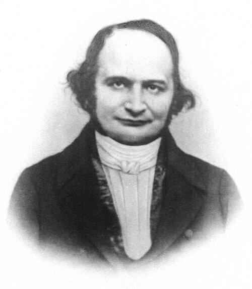

# Carl Gustav Jacob Jacobi

**Born:** 10 December 1804

**Died / status:** 18 February 1851

**Fields:** Mathematical physics, Classical mechanics, Celestial mechanics

For the date, creator, form and attribution of this image, see its source record.

## Biography

Jacobi was a German mathematician who taught in Königsberg and later worked in Berlin. Alongside his major work on elliptic functions, he studied dynamics, differential equations and celestial mechanics, developing transformation and action-based methods that became central to mathematical physics.

## Major contributions to physics

- Developed Hamilton–Jacobi theory and methods for integrating its equation
- Investigated integrable cases of rigid-body dynamics
- Developed Jacobian determinants and transformation methods widely used in physics

## Image source and rights

- Source: [Original image record](https://commons.wikimedia.org/wiki/File:Carl_Jacobi.jpg)
- Creator / attribution: Unknown author
- License or rights statement: Public domain
- Local image: [477cd92cd590b9b6c173.jpg](../portraits/477cd92cd590b9b6c173.jpg)
- Credit: http://www.sil.si.edu/digitalcollections/hst/scientific-identity/explore.htm (reworked)

## Sources

- [Carl Gustav Jacob Jacobi — MacTutor, University of St Andrews](https://mathshistory.st-andrews.ac.uk/Biographies/Jacobi/)
- [Carl Gustav Jacob Jacobi — Wikipedia — dates and biographical overview](https://en.wikipedia.org/wiki/Carl_Gustav_Jacob_Jacobi)

Record reviewed: 2026-10-26.
