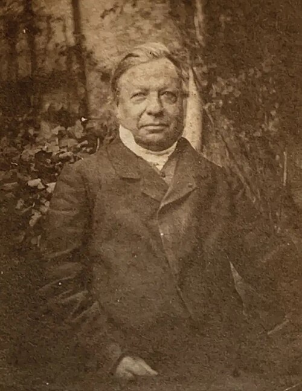

# Joseph Liouville

**Born:** 24 March 1809

**Died / status:** 8 September 1882

**Fields:** Mathematical physics, Classical mechanics, Statistical physics

For the date, creator, form and attribution of this image, see its source record.

## Biography

Liouville was a French mathematician who taught at the École Polytechnique and Collège de France and founded an influential mathematical journal. His work spanned differential equations, number theory and mechanics; his phase-space conservation theorem later became fundamental to statistical physics.

## Major contributions to physics

- Established conservation of phase-space volume under Hamiltonian evolution
- Developed Sturm–Liouville eigenvalue theory with Charles-François Sturm
- Advanced differential-equation and integration methods used throughout mathematical physics

## Image source and rights

- Source: [Original image record](https://commons.wikimedia.org/wiki/File:Photo_of_Joseph_Liouville_1868.jpg)
- Creator / attribution: Marie Liouville (1845–1913)
- License or rights statement: [Public domain](https://commons.wikimedia.org/wiki/File:Photo_of_Joseph_Liouville_1868.jpg)
- Local image: [f9d4cabf28065b6ee611.jpg](../portraits/f9d4cabf28065b6ee611.jpg)
- Credit: https://www.lajauneetlarouge.com/le-college-de-france-et-les-x-au-xixe-siecle-le-savant-et-le-politique/

## Sources

- [Joseph Liouville — MacTutor, University of St Andrews](https://mathshistory.st-andrews.ac.uk/Biographies/Liouville/)
- [Joseph Liouville — Wikipedia — dates and biographical overview](https://en.wikipedia.org/wiki/Joseph_Liouville)

Record reviewed: 2026-10-26.
