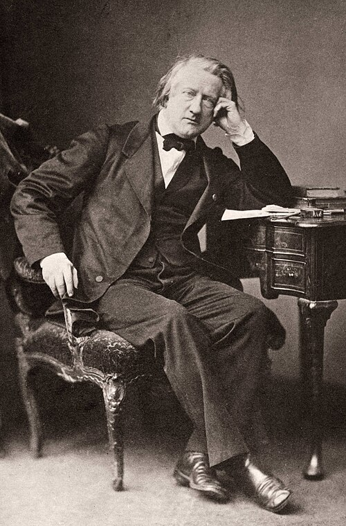

# Henri Victor Regnault

**Born:** 21 July 1810

**Died / status:** 19 January 1878

**Fields:** Thermal physics, Thermodynamics, Metrology

For the date, creator, form and attribution of this image, see its source record.

## Biography

Regnault was a French chemist and physicist who held a chair at the Collège de France and directed the Sèvres porcelain works. His careful measurements of gases, vapours and thermal properties supplied dependable quantitative data for the development of thermodynamics.

## Major contributions to physics

- Measured gas heat capacities, expansion and compression with high precision
- Systematically studied steam pressure and the heat of vaporization
- Improved instruments and methods for measuring temperature, pressure and heat

## Image source and rights

- Source: [Original image record](https://commons.wikimedia.org/wiki/File:Henri_Victor_Regnault_1860s.jpg)
- Creator / attribution: Unknown (Mondadori Publishers)
- License or rights statement: [Public domain](https://commons.wikimedia.org/wiki/File:Henri_Victor_Regnault_1860s.jpg)
- Local image: [5f4f6a7c02b9f5ffaa40.jpg](../portraits/5f4f6a7c02b9f5ffaa40.jpg)
- Credit: http://www.gettyimages.co.uk/detail/news-photo/portrait-of-the-french-chemist-and-physicist-henri-victor-news-photo/141553144

## Sources

- [Henri Victor Regnault — Wikipedia — dates and biographical overview](https://en.wikipedia.org/wiki/Henri_Victor_Regnault)

Record reviewed: 2026-10-26.
