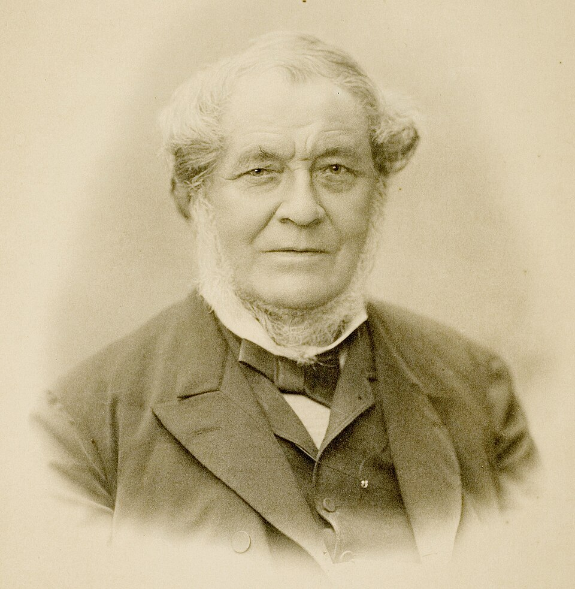

# Robert Bunsen

**Born:** 30 March 1811

**Died / status:** 16 August 1899

**Fields:** Spectroscopy, Experimental methods, Physical chemistry

For the date, creator, form and attribution of this image, see its source record.

## Biography

Bunsen was a German chemist and experimental scientist who worked for many years at Heidelberg. In collaboration with Kirchhoff, he made flame spectra into an analytical tool. His instruments and methods also transformed laboratory work in gas analysis, combustion and calorimetry.

## Major contributions to physics

- Established spectroscopic chemical analysis with Kirchhoff
- Discovered caesium and rubidium through their characteristic spectra
- Improved gas analysis, calorimetry and combustion apparatus

## Historical and source notes

- The birth date follows the historically revised date of 30 March 1811; older sources often give 31 March.

## Image source and rights

- Source: [Original image record](https://commons.wikimedia.org/wiki/File:Robert_Wilhelm_Bunsen_%28HeidICON_53016%29_%28cropped%29.jpg)
- Creator / attribution: Unknown
- License or rights statement: [CC BY-SA 4.0](https://commons.wikimedia.org/wiki/File:Robert_Wilhelm_Bunsen_%28HeidICON_53016%29_%28cropped%29.jpg)
- Local image: [b1f6d183f94529c0f17f.jpg](../portraits/b1f6d183f94529c0f17f.jpg)
- Credit: HeidICON via Prometheus

## Sources

- [Robert Bunsen — Wikipedia — dates and biographical overview](https://en.wikipedia.org/wiki/Robert_Bunsen)

Record reviewed: 2026-10-26.
