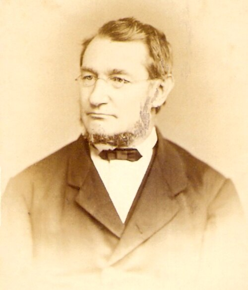

# Julius Robert von Mayer

**Born:** 25 November 1814

**Died / status:** 20 March 1878

**Fields:** Thermodynamics, Energy conservation, Natural philosophy

For the date, creator, form and attribution of this image, see its source record.

## Biography

Mayer was a German physician and natural investigator who travelled to the tropics as a ship's doctor. Questions about metabolism, heat and work led him toward energy conservation. Initially underappreciated, his work became an important part of nineteenth-century thermodynamics.

## Major contributions to physics

- Argued that heat and mechanical work can be quantitatively converted into one another
- Estimated the mechanical equivalent of heat from gas heat capacities
- Applied energy-conservation ideas to physiological and other natural processes

## Image source and rights

- Source: [Original image record](https://commons.wikimedia.org/wiki/File:Julius_Robert_Mayer_von_Friedrich_Berrer_(portrait).jpg)
- Creator / attribution: Friedrich Berrer
- License or rights statement: Public domain
- Local image: [66860d8debab093f7efc.jpg](../portraits/66860d8debab093f7efc.jpg)
- Credit: taken from https://www.booksandthings.co.uk/Prints/meyer.php and cropped

## Sources

- [Julius Robert von Mayer — Wikipedia — dates and biographical overview](https://en.wikipedia.org/wiki/Julius_Robert_von_Mayer)

Record reviewed: 2026-10-26.
