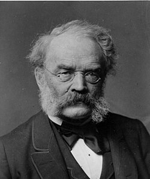

# Werner von Siemens

**Born:** 13 December 1816

**Died / status:** 6 December 1892

**Fields:** Electromagnetism, Electrical measurement, Applied physics

For the image’s date, creator and attribution, see its source record.

## Biography

Siemens was a German electrical engineer, inventor and industrial research organizer trained in the Prussian army. He founded a company with Halske and translated electromagnetic experiments into generators, telegraphy and electrical measurement, contributing to nineteenth-century power systems.

## Major contributions to physics

- Independently contributed to the discovery and development of self-excited dynamo generation
- Improved telegraphs, insulated cables and electrical equipment
- Developed electrical measuring instruments, including electrodynamometers for direct and alternating currents

## Historical and source notes

- Included as an engineer and inventor for important electromagnetic or electronic experimental contributions; these technologies developed through the work of multiple pioneers.

## Image source and rights

- Source: [Original image record](https://commons.wikimedia.org/wiki/File:Wvs_1885.jpg)
- Creator / attribution: Photograph
- License or rights statement: Public domain
- Local image: [2ff6ac538349e7059198-451c84ee6a.jpg](../portraits/2ff6ac538349e7059198-451c84ee6a.jpg)
- Credit: www.siemens.com

## Sources

- [Werner von Siemens — Magnet Academy, National High Magnetic Field Laboratory](https://maglabweb.magnet.fsu.edu/magnet-academy/history-of-electricity-magnetism/pioneers/werner-von-siemens/)
- [Werner von Siemens — Wikipedia biography](https://en.wikipedia.org/wiki/Werner_von_Siemens)
- [Siemens electrodynamometer — Smithsonian National Museum of American History](https://americanhistory.si.edu/collections/object/nmah_1183906)

Record reviewed: 2026-10-26.
