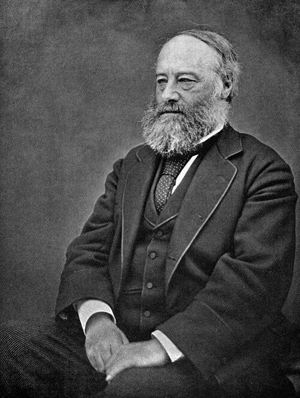

# James Prescott Joule

**Born:** 24 December 1818

**Died / status:** 11 October 1889

**Fields:** Thermodynamics, Electricity, Experimental physics

For the date, creator, form and attribution of this image, see its source record.

## Biography

Joule was an English experimental physicist from a brewing family near Manchester. Working largely through privately supported experiments, he compared electrical, mechanical and thermal effects with unusual precision. He later collaborated with William Thomson and became a key founder of thermodynamics.

## Major contributions to physics

- Measured the mechanical equivalent of heat through paddle-wheel and other experiments
- Established the quantitative law of heating by electric currents
- Investigated throttling-induced temperature changes in gases with Thomson

## Image source and rights

- Source: [Original image record](https://commons.wikimedia.org/wiki/File:Joule_James_sitting.jpg)
- Creator / attribution: Henry Roscoe
- License or rights statement: Public domain
- Local image: [0d84e9e244241956453e.jpg](../portraits/0d84e9e244241956453e.jpg)
- Credit: The Life & Experiences of Sir Henry Enfield Roscoe (Macmillan: London and New York), p. 120

## Sources

- [James Prescott Joule — Wikipedia — dates and biographical overview](https://en.wikipedia.org/wiki/James_Prescott_Joule)

Record reviewed: 2026-10-26.
