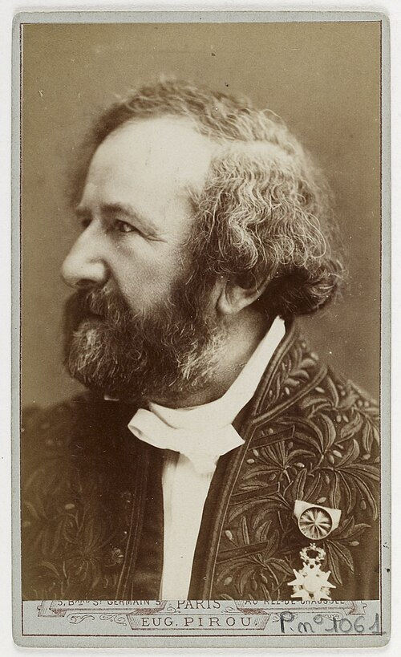

# Hippolyte Fizeau

**Born:** 23 September 1819

**Died / status:** 18 September 1896

**Fields:** Optics, Measurements of light speed, Experimental physics

For the date, creator, form and attribution of this image, see its source record.

## Biography

Fizeau was a French experimental physicist from a Paris medical family who largely worked independently. He studied photography and optics with collaborators including Foucault, devising toothed-wheel and interference experiments that made light propagation and moving-media theories accessible to terrestrial tests.

## Major contributions to physics

- Made an early successful terrestrial measurement of light speed using a rotating toothed wheel
- Measured light propagation in flowing water and its partial-drag effect
- Applied interference methods to precision optical measurements

## Image source and rights

- Source: [Original image record](https://commons.wikimedia.org/wiki/File:Armand_Hippolyte_Louis_Fizeau_by_Eug%C3%A8ne_Pirou_-_Original.jpg)
- Creator / attribution: Eugène Pirou (1841-1909)
- License or rights statement: Public domain
- Local image: [94e92f2a5d4d3796b082.jpg](../portraits/94e92f2a5d4d3796b082.jpg)
- Credit: This file comes from Gallica Digital Library and is available under the digital ID btv1b84497649

## Sources

- [Hippolyte Fizeau — MacTutor, University of St Andrews](https://mathshistory.st-andrews.ac.uk/Biographies/Fizeau/)
- [Hippolyte Fizeau — Wikipedia — dates and biographical overview](https://en.wikipedia.org/wiki/Hippolyte_Fizeau)

Record reviewed: 2026-10-26.
