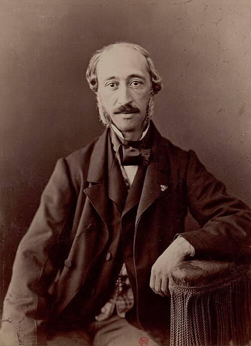

# Alexandre Edmond Becquerel

**Born:** 24 March 1820

**Died / status:** 11 May 1891

**Fields:** Photoelectric effects, Luminescence, Photochemistry

For the date, creator, form and attribution of this image, see its source record.

## Biography

Edmond Becquerel was a French physicist from a family spanning several generations of scientists, and the father of Henri Becquerel. Working in Paris, including at the natural history museum, he investigated sunlight, electrochemistry and luminescence through experiments on light–matter interactions.

## Major contributions to physics

- Discovered the photovoltaic effect in an electrochemical system
- Investigated phosphorescence and fluorescence and improved luminescence measurements
- Studied the solar spectrum and photochemical processes connected with photography

## Image source and rights

- Source: [Original image record](https://commons.wikimedia.org/wiki/File:Edmond_Becquerel_by_Nadar.jpg)
- Creator / attribution: Nadar (1820–1910)
- License or rights statement: [Public domain](https://commons.wikimedia.org/wiki/File:Edmond_Becquerel_by_Nadar.jpg)
- Local image: [98d197d6610663417723.jpg](../portraits/98d197d6610663417723.jpg)

## Sources

- [Alexandre Edmond Becquerel — Wikipedia — dates and biographical overview](https://en.wikipedia.org/wiki/Alexandre_Edmond_Becquerel)

Record reviewed: 2026-10-26.
