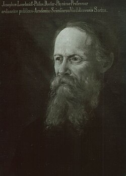

# Johann Josef Loschmidt

**Born:** 15 March 1821

**Died / status:** 8 July 1895

**Fields:** Statistical physics, Molecular physics, Kinetic theory of gases

For the date, creator, form and attribution of this image, see its source record.

## Biography

Loschmidt was a Bohemian-born Austrian scientist who worked in industry and teaching before researching at the University of Vienna. He connected ideas about molecular structure with kinetic theory, estimated molecular dimensions and challenged explanations of macroscopic irreversibility based on reversible microscopic laws.

## Major contributions to physics

- Estimated molecular sizes and the number of molecules per unit volume of gas
- Raised the reversibility objection to Boltzmann's account of irreversibility
- Investigated connections between molecular structure and gas kinetic theory

## Image source and rights

- Source: [Original image record](https://commons.wikimedia.org/wiki/File:Johann_Josef_Loschmidt.jpg)
- Creator / attribution: The original uploader was Obersachse at Russian Wikipedia.
- License or rights statement: [Public domain](https://commons.wikimedia.org/wiki/File:Johann_Josef_Loschmidt.jpg)
- Local image: [0388627e3d3d66b54096.jpg](../portraits/0388627e3d3d66b54096.jpg)
- Credit: Transferred from ru.wikipedia to Commons.

## Sources

- [Johann Josef Loschmidt — Wikipedia — dates and biographical overview](https://en.wikipedia.org/wiki/Johann_Josef_Loschmidt)

Record reviewed: 2026-10-26.
