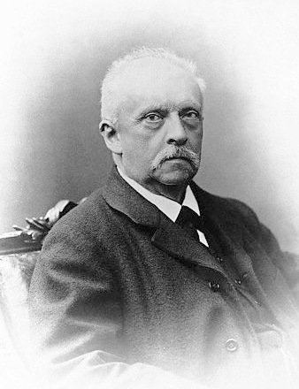

# Hermann von Helmholtz

**Born:** 31 August 1821

**Died / status:** 8 September 1894

**Fields:** Thermodynamics, Fluid mechanics, Acoustics, Optics

For the date, creator, form and attribution of this image, see its source record.

## Biography

Helmholtz was a German physician, physicist and physiologist who entered research through military medicine. He taught at several universities and later directed research in Berlin. His work joined precise measurement and mathematical explanation across energy, fluids, sound and visual perception.

## Major contributions to physics

- Gave an influential systematic account of energy conservation and its mechanical basis
- Developed vortex-motion theory and fundamental results in fluid mechanics
- Investigated acoustic resonance, timbre and vision at the interface of physics and physiology

## Image source and rights

- Source: [Original image record](https://commons.wikimedia.org/wiki/File:Hermann_von_Helmholtz.jpg)
- Creator / attribution: See the original image record
- License or rights statement: Public domain
- Local image: [d0c51cc1021d3ba88a40.jpg](../portraits/d0c51cc1021d3ba88a40.jpg)

## Sources

- [Hermann von Helmholtz — MacTutor, University of St Andrews](https://mathshistory.st-andrews.ac.uk/Biographies/Helmholtz/)
- [Hermann von Helmholtz — Wikipedia — dates and biographical overview](https://en.wikipedia.org/wiki/Hermann_von_Helmholtz)

Record reviewed: 2026-10-26.
