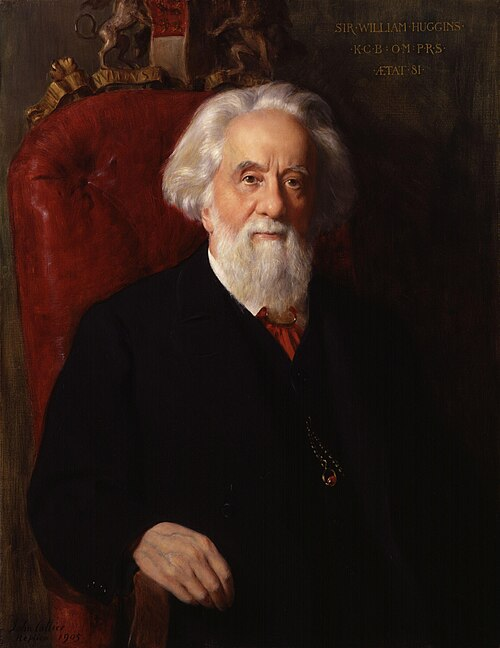

# William Huggins

**Born:** 7 February 1824

**Died / status:** 12 May 1910

**Fields:** Astrophysics, Spectroscopy, Observational astronomy

For the date, creator, form and attribution of this image, see its source record.

## Biography

Huggins was a British astronomer who built a private observatory near London and later worked closely with his wife Margaret. Applying laboratory spectroscopy to nebulae, stars and comets, he helped transform astronomy into a science of celestial composition, physical conditions and motion.

## Major contributions to physics

- Used emission spectra to show that some nebulae consist of luminous gas
- Investigated stellar radial motion through spectral-line shifts
- Advanced astronomical spectral photography and early astrophysics

## Image source and rights

- Source: [Original image record](https://commons.wikimedia.org/wiki/File:Sir_William_Huggins_by_John_Collier.jpg)
- Creator / attribution: John Collier (1850–1934)
- License or rights statement: [Public domain](https://commons.wikimedia.org/wiki/Commons:Reuse_of_PD-Art_photographs)
- Local image: [d6fd53d2397fb61d1a66.jpg](../portraits/d6fd53d2397fb61d1a66.jpg)
- Credit: National Portrait Gallery: NPG 1682

## Sources

- [William Huggins — Wikipedia — dates and biographical overview](https://en.wikipedia.org/wiki/William_Huggins)

Record reviewed: 2026-10-26.
