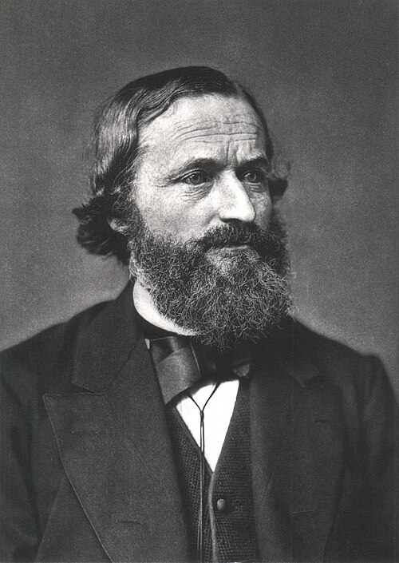

# Gustav Kirchhoff

**Born:** 12 March 1824

**Died / status:** 17 October 1887

**Fields:** Electromagnetism, Spectroscopy, Thermal radiation

For the date, creator, form and attribution of this image, see its source record.

## Biography

Kirchhoff was a German physicist who collaborated with Bunsen in Heidelberg before becoming a professor in Berlin. Combining mathematical analysis and spectral experiments, he made foundational contributions to electrical circuits, thermal radiation and optics.

## Major contributions to physics

- Formulated the junction-current and loop-voltage laws for electrical circuits
- Established spectral analysis with Bunsen and explained the connection between solar dark lines and absorption
- Formulated the absorption–emission relation for thermal radiation and introduced the black-body concept

## Image source and rights

- Source: [Original image record](https://commons.wikimedia.org/wiki/File:Gustav_Robert_Kirchhoff.jpg)
- Creator / attribution: Unknown author
- License or rights statement: [Public domain](https://commons.wikimedia.org/wiki/File:Gustav_Robert_Kirchhoff.jpg)
- Local image: [7b453a288dd9394f6a8b.jpg](../portraits/7b453a288dd9394f6a8b.jpg)
- Credit: Portrait of Gustav Kirchhoff, Smithsonian libraries (SIL-SIL14-k002-03) (image)

## Sources

- [Gustav Kirchhoff — MacTutor, University of St Andrews](https://mathshistory.st-andrews.ac.uk/Biographies/Kirchhoff/)
- [Gustav Kirchhoff — Wikipedia — dates and biographical overview](https://en.wikipedia.org/wiki/Gustav_Kirchhoff)

Record reviewed: 2026-10-26.
