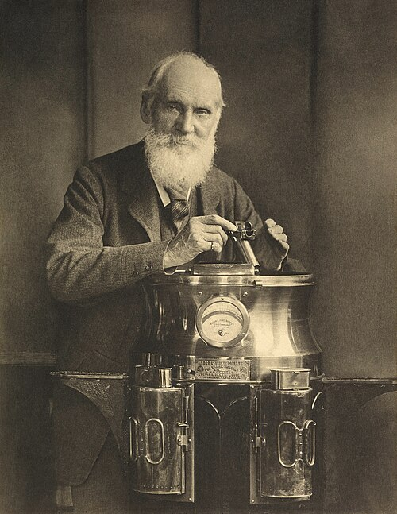

# William Thomson, 1st Baron Kelvin

**Born:** 26 June 1824

**Died / status:** 17 December 1907

**Fields:** Thermodynamics, Electromagnetism, Metrology

For the date, creator, form and attribution of this image, see its source record.

## Biography

William Thomson, later Lord Kelvin, was a Belfast-born physicist who held the Glasgow chair of natural philosophy for more than five decades. Alongside thermodynamics, electromagnetism and fluids, he worked on submarine telegraphy and precision instruments; the kelvin temperature unit bears his title.

## Major contributions to physics

- Developed an absolute temperature scale and thermodynamic temperature
- Formulated the Kelvin statement of the second law
- Advanced telegraph transmission and electrical measurement, and studied gas throttling with Joule

## Image source and rights

- Source: [Original image record](https://commons.wikimedia.org/wiki/File:Sir_William_Thomson%2C_Baron_Kelvin_by_T._%26_R._Annan_%26_Sons.jpg)
- Creator / attribution: T. & R. Annan & Sons; restored by Adam Cuerden[1]
- License or rights statement: [Public domain](https://commons.wikimedia.org/wiki/Template:PD-old)
- Local image: [b08b975dad3f425145b3.jpg](../portraits/b08b975dad3f425145b3.jpg)
- Credit: National Galleries of Scotland Accession number: PGP 230.1

## Sources

- [William Thomson, 1st Baron Kelvin — MacTutor, University of St Andrews](https://mathshistory.st-andrews.ac.uk/Biographies/Thomson/)
- [William Thomson, 1st Baron Kelvin — Wikipedia — dates and biographical overview](https://en.wikipedia.org/wiki/William_Thomson%2C_1st_Baron_Kelvin)

Record reviewed: 2026-10-26.
