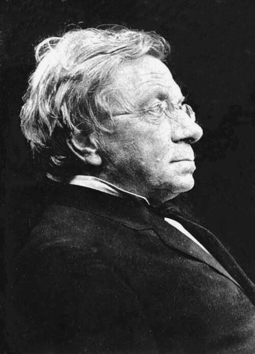

# Johann Jakob Balmer

**Born:** 1 May 1825

**Died / status:** 12 March 1898

**Fields:** Atomic spectroscopy, Mathematical physics

For the date, creator, form and attribution of this image, see its source record.

## Biography

Balmer was a Swiss mathematics teacher working in Basel rather than a professional spectroscopist. From measured hydrogen wavelengths he found a simple numerical pattern, an empirical result that later provided a crucial test for atomic models and quantum theory.

## Major contributions to physics

- Formulated the Balmer relation for hydrogen's visible spectral lines
- Predicted additional hydrogen-line wavelengths beyond those used to construct the relation
- Provided an empirical basis for later Rydberg formulas and the Bohr model

## Image source and rights

- Source: [Original image record](https://commons.wikimedia.org/wiki/File:Balmer.jpeg)
- Creator / attribution: Johann Jakob Balmer
- License or rights statement: Public domain
- Local image: [f72827c805e8283270b4.jpeg](../portraits/f72827c805e8283270b4.jpeg)
- Credit: Reproduction of a public domain painting

## Sources

- [Johann Jakob Balmer — MacTutor, University of St Andrews](https://mathshistory.st-andrews.ac.uk/Biographies/Balmer/)
- [Johann Jakob Balmer — Wikipedia — dates and biographical overview](https://en.wikipedia.org/wiki/Johann_Jakob_Balmer)

Record reviewed: 2026-10-26.
