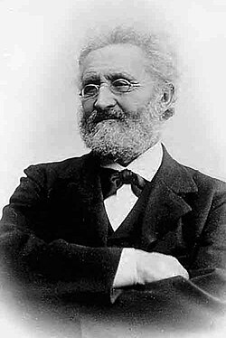

# Carl Anton Bjerknes

**Born:** 24 October 1825

**Died / status:** 20 March 1903

**Fields:** Fluid mechanics, Mathematical physics, Electromagnetic analogies

For the image’s date, creator, form and attribution, see its source record.

## Biography

Carl Anton Bjerknes was a Norwegian mathematician and physicist who moved from mining into university teaching in Christiania. Inspired by Dirichlet's hydrodynamics, he studied pulsating bodies in fluids and collaborated with his son Vilhelm on experimental tests.

## Major contributions to physics

- Investigated forces between pulsating or oscillating bodies in ideal fluids
- Developed hydrodynamic analogies for electromagnetic phenomena
- Connected mathematical fluid theory with experiments underlying later Bjerknes-force studies

## Historical and source notes

- The hydrodynamic electromagnetic analogy is a historical model, not a modern microscopic explanation of electromagnetism.

## Image source and rights

- Source: [Original image record](https://commons.wikimedia.org/wiki/File:Carl_Anton_Bjerknes2.jpg)
- Creator / attribution: Unknown author
- License or rights statement: [Public domain](https://commons.wikimedia.org/wiki/File:Carl_Anton_Bjerknes2.jpg)
- Local image: [364356c452469d50d699-b8596a91a8.jpg](../portraits/364356c452469d50d699-b8596a91a8.jpg)
- Credit: http://www.scientific-web.com/en/Mathematics/Biographies/AntonBjerknes01.html

## Sources

- [Carl Anton Bjerknes — MacTutor, University of St Andrews](https://mathshistory.st-andrews.ac.uk/Biographies/Bjerknes_Carl/)
- [Carl Anton Bjerknes — Wikipedia biography](https://en.wikipedia.org/wiki/Carl_Anton_Bjerknes)

Record reviewed: 2026-10-26.
