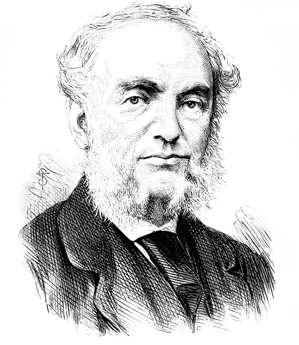

# Balfour Stewart

**Born:** 1 November 1828

**Died / status:** 19 December 1887

**Fields:** Thermal radiation, Geophysics, Metrology

For the date, creator, form and attribution of this image, see its source record.

## Biography

Stewart was a Scottish physicist who moved from commercial work into science, directed Kew Observatory and later taught in Manchester. He investigated thermal radiation, geomagnetism and meteorological instruments, contributing early experimental evidence about the relation between absorption and emission.

## Major contributions to physics

- Investigated the relation between thermal emission and absorption
- Studied geomagnetic and meteorological observations and their relation to solar activity
- Contributed to radiation measurements and physical instrumentation

## Image source and rights

- Source: [Original image record](https://commons.wikimedia.org/wiki/File:PSM_V11_D270_Balfour_Stewart.jpg)
- Creator / attribution: Unknown author
- License or rights statement: Public domain
- Local image: [213d3615f0de96c8ac68.jpg](../portraits/213d3615f0de96c8ac68.jpg)
- Credit: Popular Science Monthly Volume 11

## Sources

- [Balfour Stewart — Wikipedia — dates and biographical overview](https://en.wikipedia.org/wiki/Balfour_Stewart)

Record reviewed: 2026-10-26.
