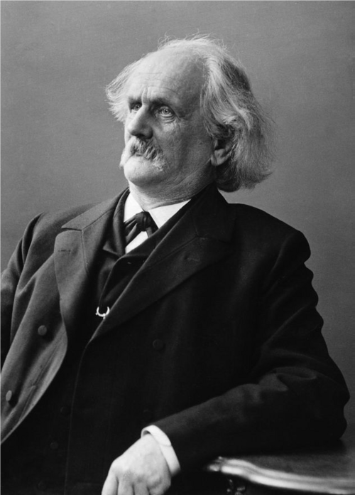

# Carl Gottfried Neumann

**Born:** 7 May 1832

**Died / status:** 27 March 1925

**Fields:** Potential theory, Mathematical physics, Boundary-value problems

For the image’s date, creator, form and attribution, see its source record.

## Biography

Carl Gottfried Neumann was a German mathematician, son of Franz Neumann, who taught for many years in Leipzig. His work on potential theory, integral equations, mechanics and optics developed systematic tools for mathematical physics; he also helped found Mathematische Annalen.

## Major contributions to physics

- Advanced potential theory and boundary-value methods prescribing normal derivatives
- Developed integral-equation methods and Neumann series
- Applied analysis to mechanics, electrostatics and optics

## Image source and rights

- Source: [Original image record](https://commons.wikimedia.org/wiki/File:Carl_Gottfried_Neumann.png)
- Creator / attribution: Photo Deutsches Museum
- License or rights statement: [CC BY-SA 4.0](https://commons.wikimedia.org/wiki/File:Carl_Gottfried_Neumann.png)
- Local image: [b87ed7eeb35641ad114b-988ad6bd53.png](../portraits/b87ed7eeb35641ad114b-988ad6bd53.png)
- Credit: Green's Functions with Applications, by Dean G. Duffy, Second Edition

## Sources

- [Carl Gottfried Neumann — MacTutor, University of St Andrews](https://mathshistory.st-andrews.ac.uk/Biographies/Neumann_Carl/)
- [Carl Gottfried Neumann — Wikipedia biography](https://en.wikipedia.org/wiki/Carl_Gottfried_Neumann)

Record reviewed: 2026-10-26.
