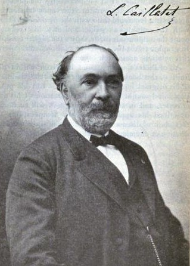

# Louis Paul Cailletet

**Born:** 21 September 1832

**Died / status:** 5 January 1913

**Fields:** Low-temperature physics, High-pressure physics, Experimental techniques

For the image’s date, creator, form and attribution, see its source record.

## Biography

Cailletet was a French experimental physicist and industrial researcher whose interest in gases grew from iron production. In 1877 his compression, cooling and rapid-expansion experiments produced evidence of oxygen liquefaction, helping overturn the idea of permanently gaseous substances.

## Major contributions to physics

- Performed early oxygen-liquefaction experiments using compression and expansion
- Developed apparatus for studying gases at high pressure
- Advanced low-temperature and gas-liquefaction techniques

## Image source and rights

- Source: [Original image record](https://commons.wikimedia.org/wiki/File:Cailletet_Louis_Paul.jpg)
- Creator / attribution: T. O'Connor Sloan
- License or rights statement: Public domain
- Local image: [19d75de30f55b32cea9c-0e8243e519.jpg](../portraits/19d75de30f55b32cea9c-0e8243e519.jpg)
- Credit: Page 172 of Liquid Air and the Liquefaction of Gases

## Sources

- [Louis Paul Cailletet — Wikipedia biography](https://en.wikipedia.org/wiki/Louis_Paul_Cailletet)

Record reviewed: 2026-10-26.
