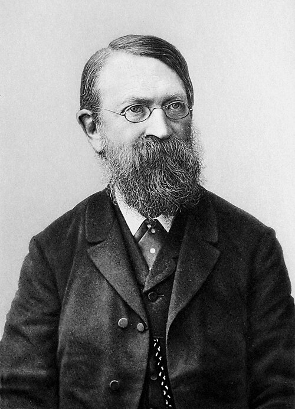

# Ernst Mach

**Born:** 18 February 1838

**Died / status:** 19 February 1916

**Fields:** Fluid mechanics, Acoustics, Foundations of physics

For the date, creator, form and attribution of this image, see its source record.

## Biography

Mach was an Austrian physicist and philosopher who taught in Graz, Prague and Vienna. He investigated high-speed motion, shock waves and perception while critically examining the concepts of classical mechanics. Both his experiments and his philosophical arguments influenced physics around the turn of the twentieth century.

## Major contributions to physics

- Photographically investigated shock waves produced by supersonic objects
- Investigated compressible flow, characterized by the Mach number: flow speed divided by the local speed of sound
- Criticized absolute space and conventional accounts of inertia, influencing Einstein's thinking about gravitation

## Image source and rights

- Source: [Original image record](https://commons.wikimedia.org/wiki/File:Ernst_Mach_01.jpg)
- Creator / attribution: Heliogravüre by H. F. Jütte, Leipzig; Scanned, image processed and uploaded by Kuebi = Armin Kübelbeck
- License or rights statement: [Public domain](https://commons.wikimedia.org/wiki/File:Ernst_Mach_01.jpg)
- Local image: [05287a79e3f82835e003.jpg](../portraits/05287a79e3f82835e003.jpg)
- Credit: Zeitschrift für Physikalische Chemie, Band 40, von 1902

## Sources

- [Ernst Mach — Wikipedia — dates and biographical overview](https://en.wikipedia.org/wiki/Ernst_Mach)

Record reviewed: 2026-10-26.
