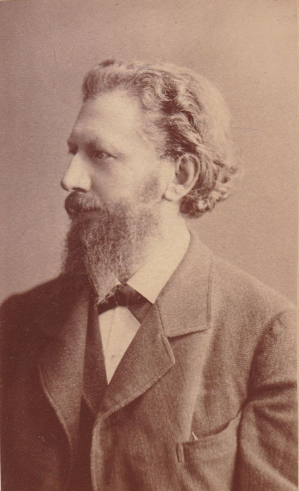

# August Kundt

**Born:** 18 November 1839

**Died / status:** 21 May 1894

**Fields:** Acoustics, Optics, Experimental physics

For the date, creator, form and attribution of this image, see its source record.

## Biography

Kundt was a German experimental physicist who taught at several universities, notably Strasbourg and Berlin. He investigated acoustics, optical dispersion and the properties of gases, combining ingenious apparatus with careful measurements and influential experimental teaching.

## Major contributions to physics

- Developed Kundt's tube for visualizing standing sound waves and measuring sound speeds
- Investigated anomalous optical dispersion and the connection between absorption and refraction
- Performed magneto-optical experiments and studied the optical properties of thin metal films

## Image source and rights

- Source: [Original image record](https://commons.wikimedia.org/wiki/File:August_Kundt-1893-1894.png)
- Creator / attribution: Anton Hruschka
- License or rights statement: Public domain
- Local image: [6a8409c13f1ad6296c99.png](../portraits/6a8409c13f1ad6296c99.png)
- Credit: ResearchGate

## Sources

- [August Kundt — Deutsche Biographie/Bavarian Academy of Sciences](https://www.deutsche-biographie.de/sfz47023.html)
- [August Kundt — Wikipedia — dates and biographical overview](https://en.wikipedia.org/wiki/August_Kundt)

Record reviewed: 2026-10-26.
