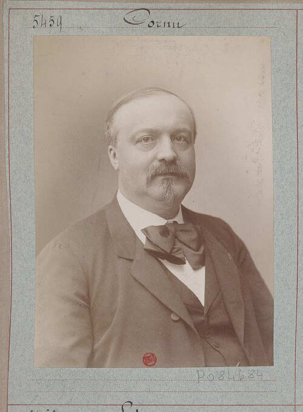

# Alfred Cornu

**Born:** 6 March 1841

**Died / status:** 12 April 1902

**Fields:** Optics, Diffraction, Metrology

For the date, creator, form and attribution of this image, see its source record.

## Biography

Cornu was a French experimental physicist who taught at the École Polytechnique. His work joined precision optics and instrumentation, including refinements of light-speed measurements, diffraction analysis and spectroscopy. His graphical treatment of diffraction remains a standard optical tool.

## Major contributions to physics

- Improved terrestrial measurements of the speed of light
- Developed the Cornu spiral for analysing Fresnel diffraction
- Investigated spectroscopy, photoelasticity and precision optical measurements

## Image source and rights

- Source: [Original image record](https://commons.wikimedia.org/wiki/File:Cornu_-_btv1b53152130b.jpg)
- Creator / attribution: Atelier Nadar; Bibliothèque nationale de France / Gallica
- License or rights statement: Public domain (PD France; PD-1996)
- Local image: [d7d03ed6629dce9b75a1-c8462c9b63.jpg](../portraits/d7d03ed6629dce9b75a1-c8462c9b63.jpg)
- Credit: Atelier Nadar, 1875–1895. Bibliothèque nationale de France, département Estampes et photographie, FT 4-NA-238 (16).

## Sources

- [Alfred Cornu — Wikipedia — dates and biographical overview](https://en.wikipedia.org/wiki/Alfred_Cornu)

Record reviewed: 2026-10-26.
