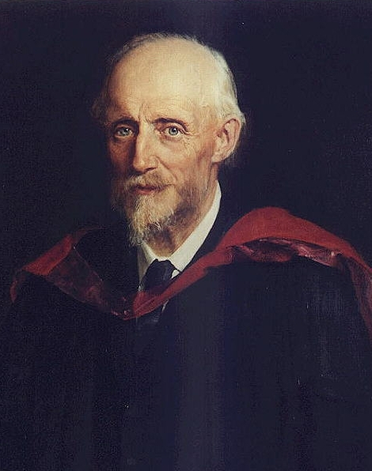

# Osborne Reynolds

**Born:** 23 August 1842

**Died / status:** 21 February 1912

**Fields:** Fluid mechanics, Turbulence, Engineering physics

For the date, creator, form and attribution of this image, see its source record.

## Biography

Reynolds was an Irish-born British engineer and physicist whose career was based in Manchester. He combined experiments with mathematical analysis to investigate flow transitions, lubrication and heat transfer. His work helped establish modern fluid mechanics and research-based engineering education.

## Major contributions to physics

- Identified the Reynolds number, a dimensionless ratio of inertial to viscous effects characterizing flow similarity
- Investigated the transition from laminar to turbulent pipe flow and developed turbulence analysis
- Established the Reynolds equation for thin-film fluid lubrication

## Historical and source notes

- The birth date follows the University of Manchester biographical study and MacTutor: 23 August 1842. The English Wikipedia infobox retrieved in this audit gives 23 October, also conflicting with its own article text.

## Image source and rights

- Source: [Original image record](https://commons.wikimedia.org/wiki/File:OsborneReynolds.jpg)
- Creator / attribution: John Collier
- License or rights statement: Public domain
- Local image: [458f1d2d43fbd803aa04.jpg](../portraits/458f1d2d43fbd803aa04.jpg)
- Credit: Copied from johnbyrne.fireflyinternet.co.uk. Cropped photo of a painting of Osborne Reynolds painted in 1904 by John Collier.

## Sources

- [Osborne Reynolds — MacTutor, University of St Andrews](https://mathshistory.st-andrews.ac.uk/Biographies/Reynolds/)
- [Osborne Reynolds — Wikipedia — dates and biographical overview](https://en.wikipedia.org/wiki/Osborne_Reynolds)
- [Osborne Reynolds — University of Manchester biographical study](https://personalpages.manchester.ac.uk/staff/jdjackson/10%20Reynolds.pdf)

Record reviewed: 2026-10-26.
