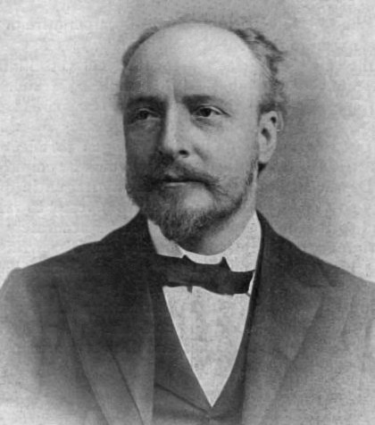

# James Dewar

**Born:** 20 September 1842

**Died / status:** 27 March 1923

**Fields:** Low-temperature physics, Experimental techniques, Physical chemistry

For the date, creator, form and attribution of this image, see its source record.

## Biography

Dewar was a Scottish chemist and physicist who worked at Cambridge and London's Royal Institution. He developed techniques for producing and investigating very low temperatures, creating vacuum-insulated vessels and pursuing the liquefaction of gases and their physical properties.

## Major contributions to physics

- Developed the vacuum-insulated Dewar vessel for storing cryogenic liquids
- Liquefied and solidified hydrogen, advancing low-temperature experimental methods
- Investigated material properties and gas adsorption at low temperatures

## Image source and rights

- Source: [Original image record](https://commons.wikimedia.org/wiki/File:James_Dewar.jpg)
- Creator / attribution: Unknown author
- License or rights statement: [Public domain](https://commons.wikimedia.org/wiki/File:James_Dewar.jpg)
- Local image: [b894b2838725a84aae61.jpg](../portraits/b894b2838725a84aae61.jpg)
- Credit: absolutezerocampaign.org

## Sources

- [James Dewar — Wikipedia — dates and biographical overview](https://en.wikipedia.org/wiki/James_Dewar)

Record reviewed: 2026-10-26.
