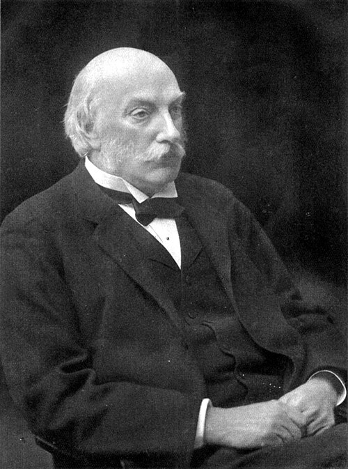

# Lord Rayleigh (John William Strutt)

**Born:** 12 November 1842

**Died / status:** 30 June 1919

**Fields:** Acoustics, Optics, Gas physics

For the photographer or artist, date and type of image, consult the original image record.

## Biography

Lord Rayleigh (John William Strutt) was born in Langford Grove, Maldon, Essex, United Kingdom and conducted research in acoustics, optics and gas physics. Nobel records list Royal Institution of Great Britain as the affiliation at the time of the award. They made precise studies of gas densities and co-discovered argon. They were awarded the Nobel Prize in Physics in 1904.

## Major contributions to physics

- Made precise studies of gas densities and co-discovered argon
- Developed theories of waves, sound and the scattering of light

**Nobel Prize in Physics:** 1904

## Image source and rights

- Source: [Original image record](https://commons.wikimedia.org/wiki/File:John_William_Strutt.jpg)
- Creator / attribution: Unknown author
- License or rights statement: Public domain
- Local image: [e971ab1a60b3f438a75a.jpg](../portraits/e971ab1a60b3f438a75a.jpg)
- Credit: From "Obituary Notices of Fellows Deceased," Proceedings of the Royal Society of London. Series A, Containing Papers of a Mathematical and Physical Character Vol. 98, No. 695 (Mar. 24, 1921).

## Sources

- [Lord Rayleigh - Facts](https://www.nobelprize.org/prizes/physics/1904/strutt/facts/)
- [Nobel Prize official laureate API, id 8](https://api.nobelprize.org/2.1/laureate/8)
- [Wikipedia: John Strutt, 3rd Baron Rayleigh](https://en.wikipedia.org/wiki/John_Strutt%2C_3rd_Baron_Rayleigh)

Record reviewed: 2026-10-26.
