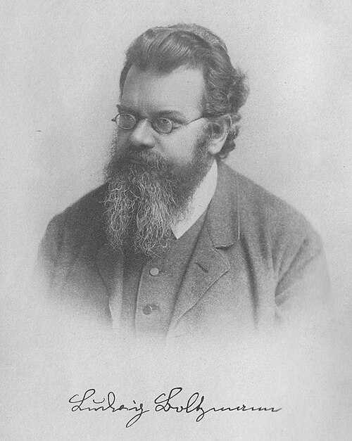

# Ludwig Boltzmann

**Born:** 20 February 1844

**Died / status:** 5 September 1906

**Fields:** Statistical physics, Kinetic theory of gases, Thermal radiation

For the date, creator, form and attribution of this image, see its source record.

## Biography

Boltzmann was an Austrian theoretical physicist who held posts in Graz, Vienna and other European universities. He related the thermal behaviour of matter to microscopic motion and probability, defending atomistic explanations and establishing central ideas of statistical mechanics.

## Major contributions to physics

- Formulated the Boltzmann transport equation and H-theorem to study the approach of gases to equilibrium
- Related entropy to the number of microscopic states and developed a statistical interpretation of the second law
- Derived the thermal-radiation fourth-power law theoretically from thermodynamics and electromagnetism

## Image source and rights

- Source: [Original image record](https://commons.wikimedia.org/wiki/File:Boltzmann2.jpg)
- Creator / attribution: Unknown author
- License or rights statement: Public domain
- Local image: [c4939df0f17de5737e18.jpg](../portraits/c4939df0f17de5737e18.jpg)
- Credit: A version is at Uni Frankfurt. The new source is not linked, but note I did clean up some water damage at the edges.

## Sources

- [Ludwig Boltzmann — MacTutor, University of St Andrews](https://mathshistory.st-andrews.ac.uk/Biographies/Boltzmann/)
- [Ludwig Boltzmann — Wikipedia — dates and biographical overview](https://en.wikipedia.org/wiki/Ludwig_Boltzmann)

Record reviewed: 2026-10-26.
