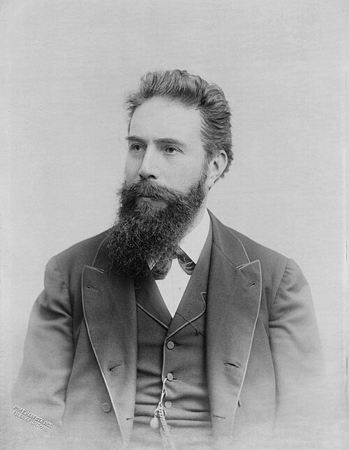

# Wilhelm Conrad Röntgen

**Born:** 27 March 1845

**Died / status:** 10 February 1923

**Fields:** Experimental physics, X-rays

For the photographer or artist, date and type of image, consult the original image record.

## Biography

Wilhelm Conrad Röntgen was born in Lennep, Prussia (now Remscheid, Germany) and conducted research in experimental physics and X-rays. Nobel records list Munich University as the affiliation at the time of the award. They discovered X-rays and investigated their penetrating properties. They were awarded the Nobel Prize in Physics in 1901.

## Major contributions to physics

- Discovered X-rays and investigated their penetrating properties
- Opened a new way to examine the internal structure of matter

**Nobel Prize in Physics:** 1901

## Image source and rights

- Source: [Original image record](https://commons.wikimedia.org/wiki/File:Wilhelm_Conrad_R%C3%B6ntgen_(1888-1900),_88374_p.jpg)
- Creator / attribution: Erwin Hanfstaengl
- License or rights statement: Public domain
- Local image: [731d8208ef1fa9be78d5.jpg](../portraits/731d8208ef1fa9be78d5.jpg)
- Credit: https://global.museum-digital.org/singleimage?imagenr=2399678

## Sources

- [Wilhelm Conrad Röntgen - Facts](https://www.nobelprize.org/prizes/physics/1901/rontgen/facts/)
- [Nobel Prize official laureate API, id 1](https://api.nobelprize.org/2.1/laureate/1)
- [Wikipedia: Wilhelm Röntgen](https://en.wikipedia.org/wiki/Wilhelm_R%C3%B6ntgen)

Record reviewed: 2026-10-26.
