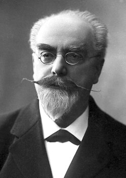

# Gabriel Lippmann

**Born:** 16 August 1845

**Died / status:** 13 July 1921

**Fields:** Optics, Imaging

For the photographer or artist, date and type of image, consult the original image record.

## Biography

Gabriel Lippmann was born in Hollerich, Luxembourg and conducted research in optics and imaging. Nobel records list Sorbonne University as the affiliation at the time of the award. They developed a colour-photography method based on optical interference and standing waves. They were awarded the Nobel Prize in Physics in 1908.

## Major contributions to physics

- Developed a colour-photography method based on optical interference and standing waves
- Used the wave properties of light to record colour information

**Nobel Prize in Physics:** 1908

## Historical and source notes

- The date of death, 13 July 1921, was checked against the Strasbourg Institute of Earth Physics' 1923 memorial. The 12 July date found in some online infoboxes is not adopted.

## Image source and rights

- Source: [Original image record](https://commons.wikimedia.org/wiki/File:Gabriel_Lippmann2.jpg)
- Creator / attribution: Nobel Foundation
- License or rights statement: Public domain
- Local image: [b117d2e999f5b6a49b8e.jpg](../portraits/b117d2e999f5b6a49b8e.jpg)
- Credit: http://nobelprize.org/nobel_prizes/physics/laureates/1908/lippmann-bio.html

## Sources

- [Gabriel Lippmann - Facts](https://www.nobelprize.org/prizes/physics/1908/lippmann/facts/)
- [Nobel Prize official laureate API, id 12](https://api.nobelprize.org/2.1/laureate/12)
- [Wikipedia: Gabriel Lippmann](https://en.wikipedia.org/wiki/Gabriel_Lippmann)
- [Edmond Rothé: Gabriel Lippmann memorial, Institut de physique du Globe de Strasbourg (1923)](https://www.persee.fr/doc/aipgs_1245-687x_1923_num_4_1_1915)

Record reviewed: 2026-10-26.
