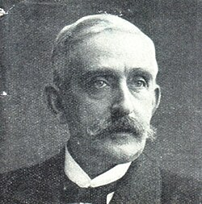

# Emil Warburg

**Born:** 9 March 1846

**Died / status:** 28 July 1931

**Fields:** Magnetism, Physical chemistry, Metrology

For the image’s date, creator, form and attribution, see its source record.

## Biography

Warburg was a German physicist who worked in Strasbourg, Freiburg and Berlin and headed the Physikalisch-Technische Reichsanstalt. His research ranged across kinetic theory, electromagnetic phenomena and photochemistry, connecting experiment, theory and physical standards.

## Major contributions to physics

- Related the area of a magnetic hysteresis loop to energy dissipation
- Investigated rarefied gases and mercury-vapour thermal properties with Kundt
- Advanced electrochemical diffusion, photochemistry and physical metrology

## Image source and rights

- Source: [Original image record](https://commons.wikimedia.org/wiki/File:Emil_Gabriel_Warburg_%281846-1931%29.jpg)
- Creator / attribution: uploaded by BhangraGirl at en.wikipedia
- License or rights statement: [Public domain](https://commons.wikimedia.org/wiki/File:Emil_Gabriel_Warburg_%281846-1931%29.jpg)
- Local image: [82a397574ac1d5282a67-0ba82c5368.jpg](../portraits/82a397574ac1d5282a67-0ba82c5368.jpg)
- Credit: http://photography.si.edu/upload/Images/md_3649_Image_SIL14-w001-05.jpg Transferred from en.wikipedia by SreeBot

## Sources

- [Emil Warburg — Neue Deutsche Biographie](https://www.deutsche-biographie.de/sfz18948.html)
- [Emil Warburg — Wikipedia biography](https://en.wikipedia.org/wiki/Emil_Warburg)

Record reviewed: 2026-10-26.
