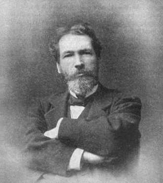

# Raoul Pictet

**Born:** 4 April 1846

**Died / status:** 24 July 1929

**Fields:** Low-temperature physics, Thermodynamics, Applied physics

For the image’s date, creator, form and attribution, see its source record.

## Biography

Pictet was a Swiss physicist who taught in Cairo and Geneva before pursuing cryogenic research and industry in Berlin and Paris. His cascade-refrigeration and high-pressure experiments contributed to oxygen liquefaction independently of Cailletet's work in the same period.

## Major contributions to physics

- Investigated oxygen liquefaction using cascade cooling and high pressure
- Developed refrigeration machinery and cryogenic methods
- Applied thermodynamics to industrial refrigeration and liquefaction equipment

## Historical and source notes

- The death date follows the Historical Dictionary of Switzerland: 24 July 1929. Some English references give 27 July.
- Early oxygen liquefaction involved independent work by Cailletet and Pictet; no sole-discoverer claim is made.

## Image source and rights

- Source: [Original image record](https://commons.wikimedia.org/wiki/File:Pictet_Raoul.jpg)
- Creator / attribution: T. O'Connor Sloan
- License or rights statement: Public domain
- Local image: [82aacb336bb5f2fc2e8d-4ea990399a.jpg](../portraits/82aacb336bb5f2fc2e8d-4ea990399a.jpg)
- Credit: Page 152 of Liquid Air and the Liquefaction of Gases

## Sources

- [Raoul Pictet — Historical Dictionary of Switzerland](https://hls-dhs-dss.ch/fr/articles/028910/2024-10-01/)
- [Raoul Pictet — Wikipedia biography](https://en.wikipedia.org/wiki/Raoul_Pictet)

Record reviewed: 2026-10-26.
